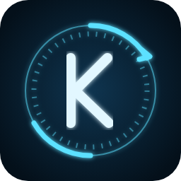
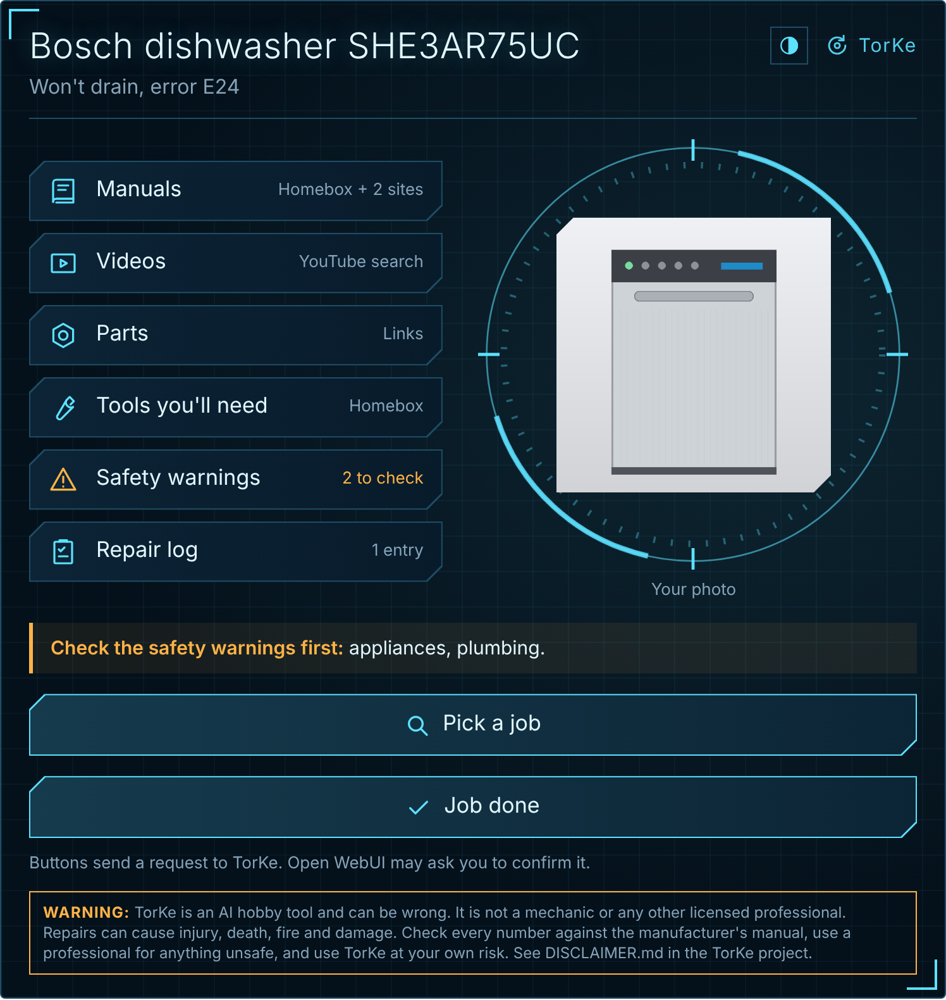
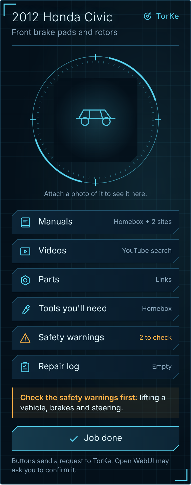
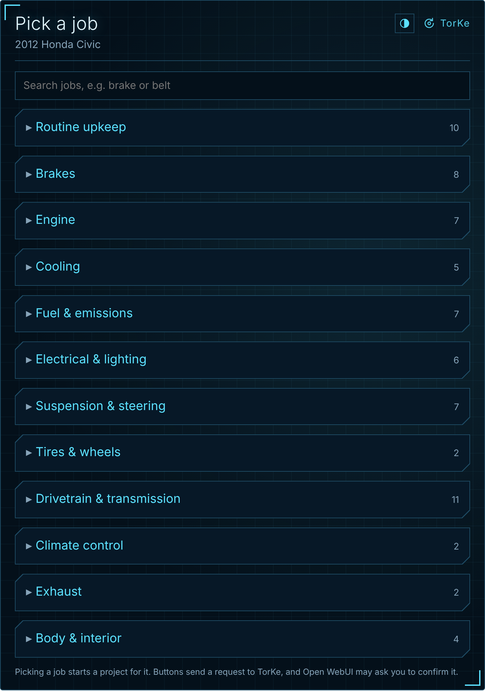
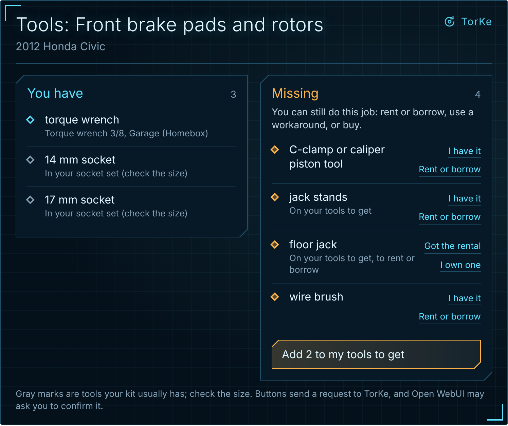
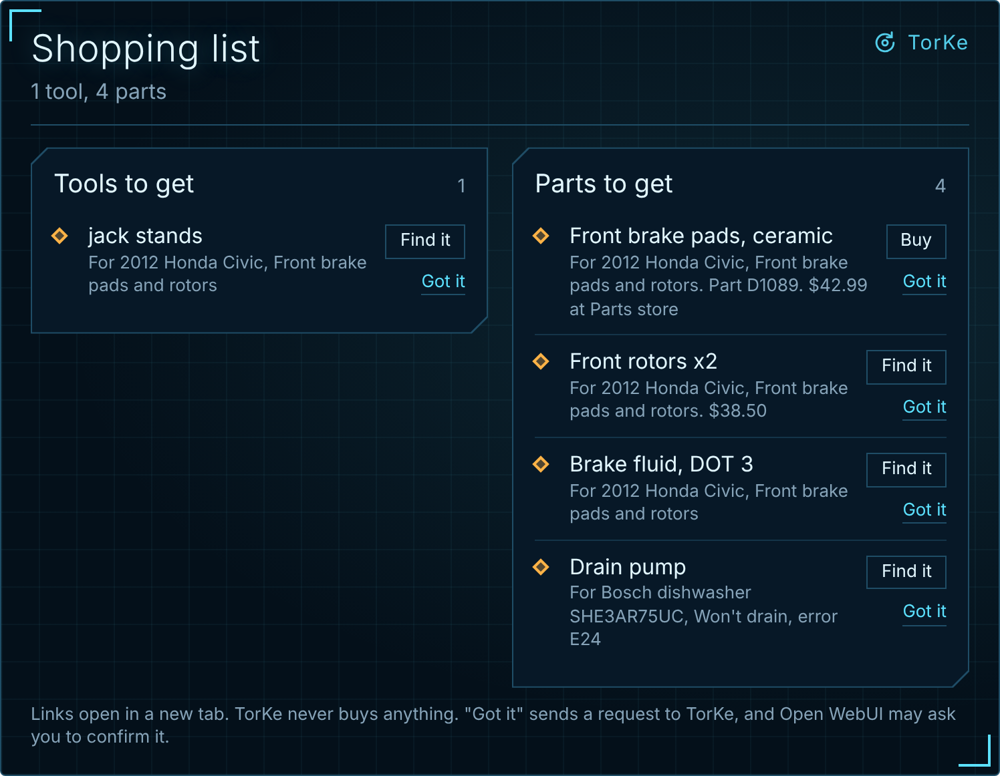
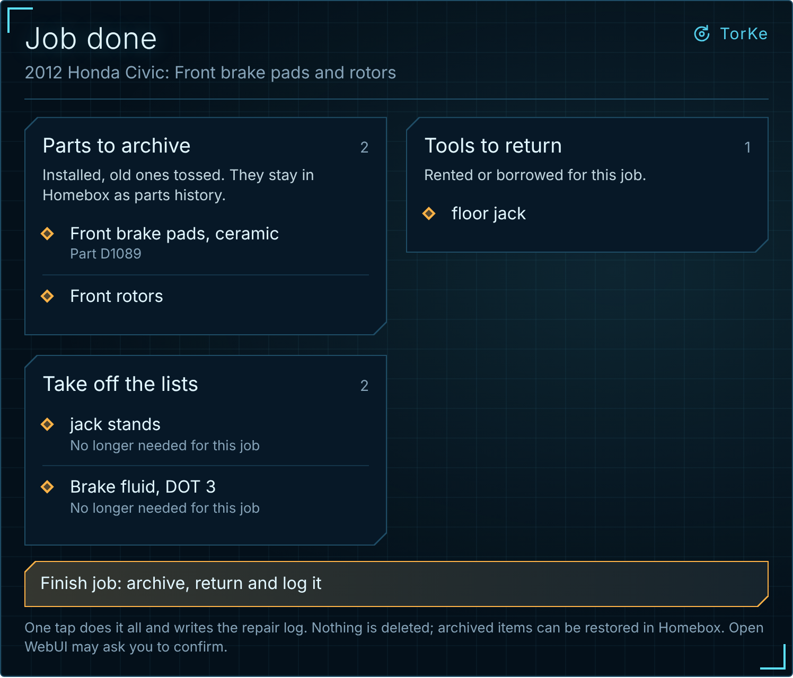

# TorKe

Fix it yourself with pubs and videos.

TorKe (say "torque") is a repair coach for [Open WebUI](https://openwebui.com). It brings each job's manuals and repair documents together with the tools and parts the job needs, and keeps all of it in [Homebox](https://homebox.software). Tell it what you're fixing and it opens a project card in the chat: a picture of the thing on the right, and six buttons on the left. It helps with vehicles, appliances, tools, electronics, yard equipment and the house.

  

  

## What the buttons do

| Button | What it does | Out of the box |
|---|---|---|
| **Manuals** | Reads your own manual (attached to the item in Homebox or in the chat), then finds manuals and guides on the sites you turn on | A web search link |
| **Videos** | Shows YouTube how-to videos as cards you can tap | A YouTube search link. Real results with SearXNG or a YouTube API key |
| **Parts** | Finds where to buy each part, matched to your model, and keeps parts to get in Homebox | Search links |
| **Tools you'll need** | Finds the job's tools in its manual and shows what you have and what's missing | Assumes a basic 100-piece tool kit, a 100-piece socket set and a multimeter |
| **Safety warnings** | Built-in rules for hazards like lifting a car, brakes, airbags, fuel, house wiring, gas and refrigerant, plus optional US recall checks | Built-in rules |
| **Repair log** | The item's own maintenance log in Homebox | Needs Homebox |

**Homebox is required** for tools, parts and the repair log. Most other options start **off**; each one is a switch in the tool's settings, so you choose what TorKe can reach.

**Pick a job.** The project card has a **Pick a job** button that opens a searchable list. Vehicles are grouped by system (brakes, engine, cooling and so on), with common jobs, jobs named in the item's own manual, iFixit guides when that's on, and what's been done or is due in its repair log. The common jobs are names only, with no intervals or specs; those come from a manual. Tap a job to start a project for it.

  

**Trouble codes.** Typed-in codes work now. Live reading is coming soon (its settings are greyed out and do nothing yet). With a small scanner bridge and an OBD-II adapter, TorKe will read the car's trouble codes, explain what each code's shape tells you, and get the meaning for your make from the manual. It only reads; it never clears codes. See [SCANNER.md](docs/SCANNER.md).

**Themes.** Every card has a theme button in its top corner: dark or light, in cyan, green, violet or red. The change shows right away, and **Save as my look** keeps it for that person, so their cards open that way next time.

## Install

1. In Open WebUI, open **Workspace > Tools**, select **+**, paste [`torke.py`](torke.py), name it **TorKe** (tool ID `torke`) and save.
2. In **Workspace > Models**, create a model named **TorKe**: choose a base model that's good at tool calling, paste [`model/torke-system-prompt.md`](model/torke-system-prompt.md) as its system prompt, turn on the TorKe tool and save. You can also import [`model/torke-model.json`](model/torke-model.json) and then choose the base model.
3. In the tool's settings, connect Homebox and turn on **Let TorKe update Homebox**.
4. Start a chat with TorKe: "My dishwasher won't drain."

The [setup guide](docs/SETUP.md) covers Homebox, every setting, SearXNG, YouTube and Home Assistant.

## Everything lives in Homebox

| What | In Homebox |
|---|---|
| Manuals | Attached to the item (type Manual) |
| Tools you own | Tagged Tools |
| Tools to get | Tagged Tools and To get, plus Rent for ones you'll rent or borrow |
| Rented or borrowed, in hand | Tagged Tools and Rent, until it goes back after the job |
| Parts to get | Tagged Parts and To get, with part number, buy link and price |
| Parts waiting to go in | On the Parts shelf |
| Installed parts | Archived, so your parts history stays |
| Repair log | The item's maintenance log |

TorKe adds items, changes only items tagged Tools or Parts, and adds repair log entries. It never deletes anything, and it saves nothing until you say yes.

## Tools

  

When there's a manual for the job (a PDF attached to the item in Homebox or in the chat, or an iFixit guide), TorKe reads the tools from it and compares them with what you own.

**A missing tool doesn't stop the job.** For each one, TorKe offers to rent or borrow it (many auto parts stores lend specialty tools), a workaround with tools you have, or buying it. Missing tools go on your tools to get. A tool you buy moves to your tools. A rental counts as yours from when you pick it up until the job's done; then TorKe asks whether it's gone back and archives it.

To add tools you own, tell TorKe ("I bought a torque wrench"), send a photo of a tool, a kit's contents list or a receipt, or tap **I have it**. TorKe never assumes a torque wrench, jack stands or specialty tools.

## Shopping list

  

Ask "What do I need to buy?" and TorKe shows tools to get and parts to get side by side. The two lists stay separate.

- **Buy** opens the store page TorKe saved, or a web search when there isn't one. **Find a rental** searches for a rental nearby. TorKe never buys anything.
- **Got it** on a tool moves it to your tools. On a rental, it marks it picked up for the job. On a part, it goes to the Parts shelf until it's installed; then it's archived and the job goes in the repair log.
- **Returning rentals** comes up when the job is over, not before.

## Job done

  

When you finish, tap **Job done** on the project card. TorKe shows everything to close out: the installed parts to archive, rented or borrowed tools to return, and anything still on the lists for that job. Type the mileage and any notes if you like (what was wrong, what fixed it, anything for next time). On a touchscreen, tapping either box pops up a bigger one: phones and tablets use their own keyboard (the number pad for mileage), and a garage or wall screen gets a number pad and a typing pad built into the card. One tap on **Finish job** does all of it and writes the repair log with the date, mileage, notes and part numbers.

## Manual sites

All off by default:

- **iFixit:** read through its official API, with credit and links.
- **ManualsLib and RepairClinic:** links only, because their terms ban or don't clearly allow automated reading.
- **Carmaker owner's manuals:** links only.
- **Operation CHARM and LEMON Manuals:** factory car manuals, in a **legal gray area**.
- **Your own sites.**

[MANUAL-SITES.md](docs/MANUAL-SITES.md) explains each one.

## Privacy

- **No outside fonts, scripts or tracking.** Cards are self-contained.
- **Pictures, when turned on,** load from the site they came from, so that site sees the request.
- **Searches** go through your own SearXNG if you set one. Otherwise TorKe gives you links to open yourself.
- **Your tools, parts and repair log** stay in your own Homebox. TorKe keeps only the open project for each chat on your Open WebUI server.
- **The scanner feed,** when turned on, reads trouble codes from a bridge on your own network. Nothing goes to the internet.
- **The whole-house switches** (upkeep, spares, VIN decoding, shop work and more) are off until you turn them on. VIN decoding and recall checks send the VIN or the make and model to NHTSA or CPSC, and the room-message switch sends text to your own Home Assistant. [HOUSE-SETUP.md](docs/HOUSE-SETUP.md) has the details.

## Safety

TorKe points you to the manual and tells you when a job is for a professional, but you're responsible for your own work. It never guesses torque specs or other critical numbers, and it treats text from websites as information, never as instructions. The software comes with no warranty (see the license).

## Status

Version 0.7.0 is a draft. It passes its offline tests, including against a stand-in Homebox, but hasn't been tested in a live Open WebUI or against a real Homebox yet. The parts to check first are listed at the end of the [setup guide](docs/SETUP.md#things-to-verify-on-your-setup).

## For developers

- `python -m pytest -q` runs the offline tests. They need `pydantic` and `pytest`.
- `python scripts/render_preview.py` redraws the preview images. It needs `playwright`, `pillow` and `pytest`.

## License

[PolyForm Noncommercial 1.0.0](LICENSE.md). You can use, change and share TorKe for free for any noncommercial purpose. Selling it, or using it in a business, is not allowed.

Required Notice: Copyright 2026 Fmielish (https://github.com/Fmielish/TorKe)
